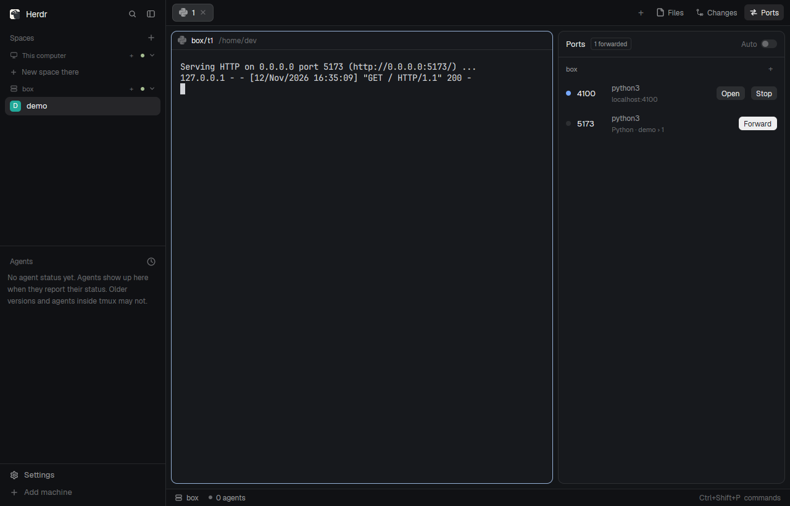

# Ports for Herdr

A [Herdr](https://herdr.dev) layout that adds a **Ports** panel beside Files and Changes. It does what VS Code's Ports panel does for remote machines: it shows what's listening on each of your ssh machines and which terminal started it, and forwards any port to this computer in one click. When a new port opens, the Ports button gets an amber dot and a notification offers to forward it. With **Auto** on, new ports are forwarded right away.



## What's in it

- `layouts/main-ports.json`: Herdr's main layout, cloned with `layout.clone`, with one more child in the side panel's stack (`ports`), and the tab bar pointed at `tabs-ports`.
- `mods/tabs-ports/`: Herdr's tab bar, cloned with `mod.clone`, plus a Ports button. Every change is marked `// herdr-ports:`.
- `mods/ports/`: the Ports panel.
- `keys.json`: `ctrl-shift-r` toggles the panel while this layout shows.

## Install

```sh
cp layouts/main-ports.json ~/.config/herdr-app/layouts/
cp -r mods/ports mods/tabs-ports ~/.config/herdr-app/mods/
```

Add the key to `~/.config/herdr-app/keys.json` as its own section:

```json
"layout:main-ports": { "ctrl-shift-r": "tabs-ports.ports" }
```

Switch to it with `ctrl-shift-l`, or `herdr-app do layout.switch '{"name":"main-ports"}'`. Your own `main` layout stays as it is, one `ctrl-shift-l` away. To remove it, switch back and delete the three files and the key.

**What it runs.** Every 5 seconds it runs `ss` (or `lsof` on macOS) and `ps` on each of your machines through Herdr, and the same listing on this computer. Each forward is an `ssh -N -L` tunnel in a herdr-core terminal on this computer, labelled `herdr-ports.*`. Nothing else goes to the network.

## How it works

- **Forward** starts `ssh -N -L 127.0.0.1:<local>:localhost:<port> <machine>` in a background terminal, on the same port number here.
- **+** on a machine forwards a port by number: the remote port, and optionally the local port. Giving a port that's already forwarded a new local port moves it.
- **When the local port isn't free**, it uses the next free one above it and a notification says where it went. On Linux, ports below 1024 need root, so they go to the port plus 8000 (80 → 8080). If something takes the port after the tunnel started, ssh's "Address already in use" is noticed within about 10 seconds and the tunnel moves to the next free port.
- The tunnel keeps running when the panel or Herdr closes. It reconnects 5 seconds after ssh drops. It ends when you click **Stop** or the core stops.
- "Connecting…" means the tunnel is up but nothing listens on this side yet. If ssh is asking for a password, click "Connecting…" to see the tunnel's terminal.
- Ports at 32768 and above are usually picked by the system for editor helpers and debuggers, so they're folded under "N more on high ports".
- The panel keeps watching while it's hidden behind Files or Changes, so the dot and notifications work whichever panel is showing.

## Updating Herdr

`main-ports` and `tabs-ports` are copies of Herdr 0.1.15's `main` layout and `tabs` mod, so they don't get Herdr's later changes to those two. After a Herdr update, re-clone them (`layout.clone`, `mod.clone`) and reapply the `// herdr-ports:` changes and the `ports` panel child.

## Limits

- Only machines added over ssh can forward. Machines added with `--via` list their ports but can't forward them.
- The tunnel uses its own ssh connection, not Herdr's shared one. With 2FA, you'll be asked once more.
- No Windows support on this side yet.

## Developing

`scripts/sandbox up` starts a throwaway Herdr (its own core, app home and virtual X display) and a Docker container with sshd, added as the machine `box`. Your own Herdr, machines and `~/.ssh` aren't touched. Needs Docker, Xvfb, ImageMagick and `uv`.

```sh
scripts/sandbox up                # box + window
scripts/sandbox install           # copy the layout and both mods in (mods hot-reload)
eval "$(scripts/sandbox env)"     # point herdr-app / hc at the sandbox
herdr-app do layout.switch '{"name":"main-ports"}'
scripts/sandbox shot              # screenshot
scripts/sandbox down              # remove everything, the box container too
```

`RECIPE.md` describes the layout in full, for rebuilding it from scratch.

## License

Apache-2.0, see [LICENSE](LICENSE). `layouts/main-ports.json` and `mods/tabs-ports/` are modified copies of [Herdr](https://github.com/herdrdev/herdr-app)'s own layout and tab bar, also Apache-2.0; [NOTICE](NOTICE) lists what changed. This project isn't made by or affiliated with the Herdr team.
