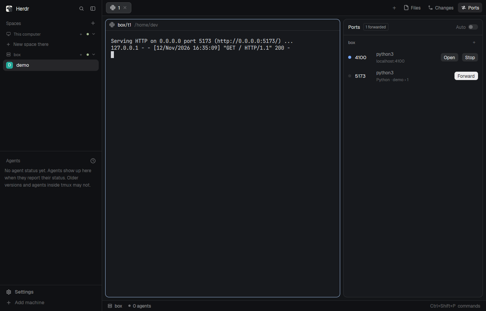

# Ports

Herdr's main layout with a **Ports** panel beside Files and Changes, like VS Code's Ports view. It lists what's listening on each of your ssh machines and which terminal started it, and forwards any of them to this computer in one click. A new port lights an amber dot on the Ports button and posts a notification that forwards it when clicked; with Auto on, it's forwarded right away.

## What you see

- **Top bar**: Herdr's tab bar, with a third panel button after Files and Changes: the `ports.svg` arrows icon and "Ports", 26 px high, `selected` background while the Ports panel shows. A 6 px `working` dot sits at its top right (4 px down, 3 px in) while a new port waits and Ports isn't the panel shown.
- **The Ports panel** fills the side panel's slot (368 px, like Files and Changes): a card with radius 10, 1 px `border`, `background` fill.
  - **Header**, 42 px, bottom border `border`: "Ports" in semibold, then a pill "N forwarded" (10 px, `muted`, 1 px `border`) when there are forwards. On the right, **Auto** with a 26×14 switch (`accent` on, `raised` off).
  - **One section per machine** (`machines()` without this computer, sorted). A 30 px header row: the name (11 px, semibold, `muted`), "Looking…" before the first answer or "Can't reach it" (`blocked`, the error as tooltip), and `+` on the right.
  - **One row per port**, padding 12/6 px, `hover` on hover: an 8 px dot (`done` when the tunnel is up and something answers there, `working` while a tunnel starts, `border` otherwise); the port number, semibold, in a 46 px column (`dim` when nothing listens there now); the process name (12 px, `muted`), followed by "· new" in `working` for a port that opened while you weren't looking; under it (11 px, `dim`) the terminal that started it ("Python · demo › 1"), or `localhost:<local>` once forwarded, or "Connecting…" in `working`. Then 22 px buttons, radius 6: **Forward** (`solid` on `solid_foreground`), or **Open** and **Stop** (`raised`).
  - Forwarded ports first, then by number. A forward whose port closed there stays, reading "nothing listening there now". "N more on high ports" (11 px, `dim`) folds ports at 32768 and up.
  - With no other machines: "No other machines yet" and how to add one.

## How it behaves

- The Ports button toggles the panel like Files and Changes, and the panel is remembered per space like theirs. `ctrl-shift-r` does the same while this layout shows.
- Every 5 s the panel asks each machine what's listening and which process opened it (one `exec` there), and asks this computer which local ports are taken. It keeps doing so while hidden behind Files or Changes.
- Only your own processes' ports show; the system's (no process name) are skipped.
- **Forward** starts a tunnel to the same port number here, or the next free one (3000 → 3004 when 3000–3003 are taken). It turns green within a second or two: green means ssh itself listens on that port here, not just anything. **Open** opens `http://localhost:<local>`; clicking `localhost:<local>` copies the URL ("Copied"); clicking "Connecting…" peeks at the tunnel's terminal (an ssh password prompt or error); clicking the terminal line focuses that terminal. **Stop** ends the tunnel.
- `+` opens a form under the machine's header: **Remote port** → **Local port** (26 px fields, 1 px `input` border) and **Forward**, with an 11 px `dim` hint: "Local port is optional: empty uses the same number, and a taken one moves to the next free port." Enter in either field forwards; Esc closes it. A bad number shows "Ports are whole numbers from 1 to 65535" in `blocked`. A remote port that's already forwarded, given a new local port, moves to it.
- **The local port**: the one asked for (default: the remote port's number) if it's free, else the next free one above it, with a `warning` notification "localhost:3000 is taken here" / "box:5173 is on localhost:3004 instead". On Linux, below 1024 means the port plus 8000 ("Ports below 1024 need root here"). A tunnel that isn't up for two looks gets its terminal read; when ssh says "Address already in use" (or the bind is denied), it moves to the next free port with the same notification. A password prompt is left alone.
- **A new port** (after the first look at a machine, below 32768): the Ports button gets its dot, the row says "· new", and a notification "Port 4100 is listening on box" stays 12 s. Clicking it opens the Ports panel and forwards that port. Looking at the panel clears the dot and, on the next look after that, the "· new" tags. With **Auto** on, it's forwarded at once and a "Forwarded box:4100" notification says so.
- Tunnels are herdr-core terminals: they outlive the panel and the app, reconnect 5 s after ssh drops, and show again when the panel loads. They end when the core stops.

## Built from

- `layouts/main-ports.json`: `layout.clone {name: "main", as: "main-ports"}`, then the `tabs` block's mod set to `tabs-ports`, and `{ "id": "ports", "type": "block", "content": { "mod": "ports" } }` appended to the `panel-body` stack.
- `mods/tabs-ports/`: `mod.clone {name: "tabs", as: "tabs-ports"}`, then (each marked `// herdr-ports:`):
  - `panelButton` takes a `badge` and draws the dot; a third button `panelButton("ports", "Ports", "mods/ports/ports.svg", shared("ports.unseen") > 0)`, shown when the layout has a `ports` block;
  - `enabled` always includes `"ports"` (Settings' `workspace.panels` lists only Files and Changes);
  - a `nextCommand()` loop: `ports` toggles the panel (`layout.select {stack: "panel-body", child: "ports"}` + `layout.show {id: "panel"}`, or `layout.hide`); `ports-forward-<port>-<machine>` shows it and sets shared `ports.request` to `<port>-<machine>`.
- `mods/ports/`: `main.js`, `mod.json` (`place: "none"`), `ports.svg`.
  - `herdr`: `machines()`, `terminals()`, `spaces()`, `layout()`, `theme()`, `shared`/`setShared` (`ports.auto`, `ports.unseen`, `ports.request`), `notify` with `action: { name: "tabs-ports.ports-forward-<port>-<machine>" }`, `run("terminal.peek")`, `run("pane.focus")`.
  - Programs: on each machine through `exec(..., { on })`, `sh -c` with `ss -tlnpH` (or `lsof -nP -iTCP -sTCP:LISTEN -Fpcn`) then `ps -A -o pid= -o ppid=`; here the same listing, `hc machine ls --json`, `hc run --bg --no-parent --rm --label herdr-ports.machine=… --label herdr-ports.remote=… --label herdr-ports.local=… -- sh -c '<loop around ssh -N -L>'`, `hc kill`, and `xdg-open` / `open` / `cmd /c start`.
  - A port's terminal: walk the machine's process tree up from the listening pid until it meets a terminal's `pid` or `foreground.pid`, then read its `herdr.space` / `herdr.tab` labels.
- `keys.json`: `"layout:main-ports": { "ctrl-shift-r": "tabs-ports.ports" }`.

## Watch out

- A mod can't add a button to Herdr's tab bar: the Files and Changes buttons are hardcoded in the shipped `tabs` mod, and shipped layouts can't take new blocks. Hence the two clones; they don't get Herdr's later changes to `main` and `tabs`.
- `<mod>.<command>` only reaches shown copies, and the Ports panel is often hidden behind Files or Changes. So a notification's click goes to `tabs-ports` (always shown), which opens the panel and leaves the request in shared state; the Ports mod picks it up on a 400 ms timer. A hidden panel copy keeps running (timers too), which is what lets it keep watching.
- Keys bind mod commands as `<mod>.<command>` (`tabs-ports.ports`), not `<mod>:<command>`.
- Settings' `workspace.panels` may list only `files` and `changes`; don't let it hide Ports.
- Module scope is shared by every copy: the "already seen" ports live there, so notifications aren't doubled.
- Notifications last about 5 s by default: offers pass `timeout: 12000`.
- `hc kill` on a tunnel can answer "was removed": `--rm` won the race. It still stopped.
- The tunnel opens its own ssh connection (herdr-core's shared login socket is internal), so 2FA asks once more, in the tunnel's terminal. A `RemoteForward` plus `ExitOnForwardFailure` in your ssh config for that host can stop the tunnel (as in herdr#4350).
- `--via` machines list ports but can't forward. This computer isn't listed. No Windows on this side: the listing and the tunnel use `sh`.

## Done when

- `herdr-app check` passes for `mods/ports` and `mods/tabs-ports`, and `layout.switch {name: "main-ports"}` shows a Ports button after Changes, even with Settings' panel list set to Files and Changes.
- The button and `ctrl-shift-r` toggle the Ports panel in the side panel's slot.
- With `python3 -m http.server 5173` running in a space on an ssh machine, its row shows `python3` and that space and tab.
- Forward turns the dot green and `curl localhost:<shown port>` reaches the machine's server; with the port taken here, it picks the next free one and says so.
- `+` with remote 5173 and local 3000 (taken) lands on the next free port with a notification; the same remote port with local 6123 moves the tunnel there; local 80 on Linux lands on 8080 or above.
- Killing a tunnel's ssh and starting another program on its port moves the tunnel to the next free port within ~10 s.
- With the panel hidden, a new server there lights the button's dot and posts a notification within ~5 s; clicking it opens the panel and forwards that port.
- Opening the panel with the button shows the new port's "· new" tag, and the dot clears.
- Stop removes the tunnel; restarting the machine's sshd brings the tunnel back on its own.
